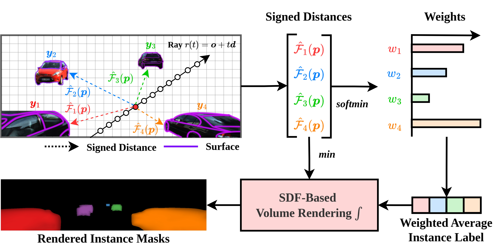
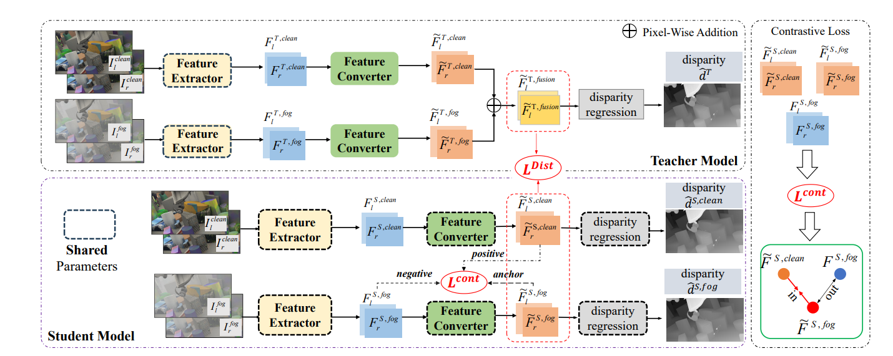
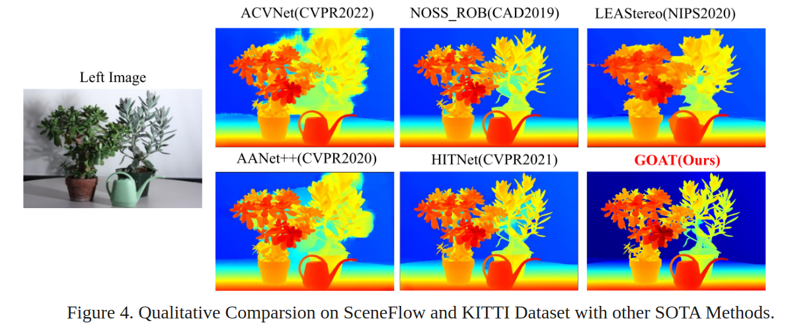
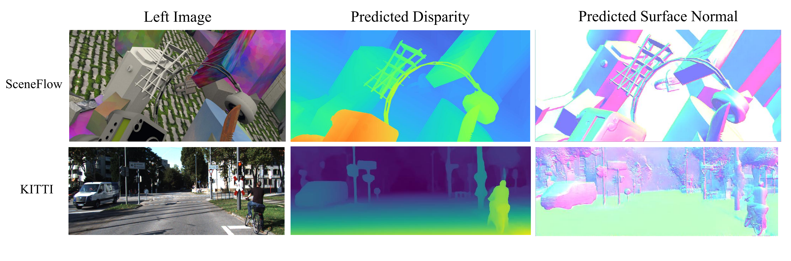
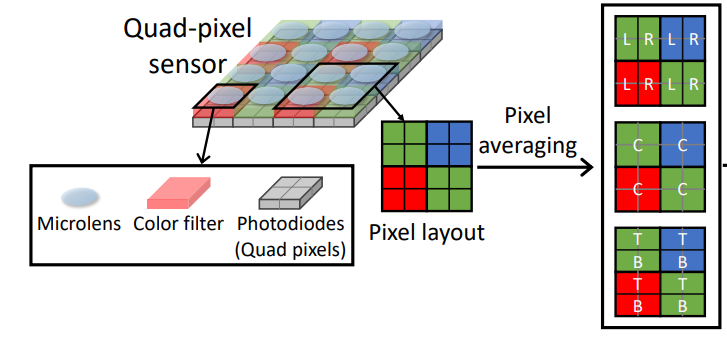
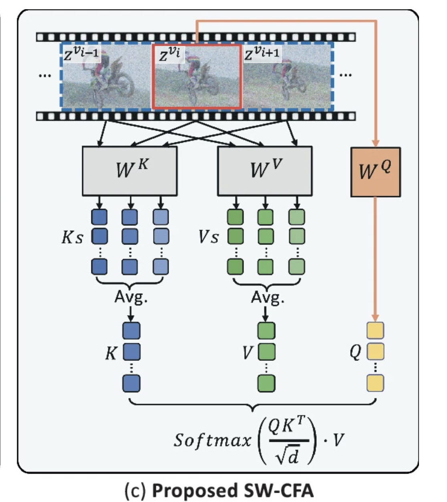

  <h3 style="margin: 0; color: #667eea;">📧 <a href="mailto:liuzihua1004@gmail.com">liuzihua1004@gmail.com</a></h3>
  

    <strong>Machine Learning Engineer</strong> 
    Woven by Toyota 
    Woven City Management — Digital Twin Platform 
    Tokyo, Japan
  

🎓 Biography
======
I am a Machine Learning Engineer at Woven by Toyota, building production perception systems for Woven City’s Digital Twin Platform. My work spans 3D reconstruction, multi-camera tracking, and vision-language reasoning, with GPU training and inference pipelines on AWS serving teams in Japan and overseas. I hold a Ph.D. in Engineering from the Institute of Science Tokyo. My research focuses on 3D vision, autonomous driving perception, and generative modeling. I review for NeurIPS, ICLR, ICML, and CVPR.

💼 Experience
======
*   **Woven by Toyota, Machine Learning Engineer** 
    Tokyo, Japan · Aug 2025–Present 
    Build the multimodal perception pipeline for Digital Genba’s logistics digital twin, from data capture and 3D Gaussian Splatting to multi-camera detection and tracking and VLM-based behavior analysis and reasoning. Run production GPU workflows on AWS and deliver reusable ML capabilities to customer teams in Japan and overseas.

*   **Sony, R&D Intern** 
    Tokyo, Japan · Jan 15–Mar 31, 2025 
    Trained a multi-view diffusion model on the GAIA GPU cluster to generate synthetic street-view and bird’s-eye-view data for autonomous perception. Built a pipeline to synchronize LiDAR, images, 3D boxes, and text.

*   **Preferred Networks, R&D Intern** 
    Tokyo, Japan · Aug 5–Sep 30, 2024 
    Developed a controllable diffusion model for background generation and tested its generalization against established methods across datasets and artistic foreground styles.

*   **SenseTime Japan, Researcher Intern** 
    Tokyo, Japan · Jun 5–Nov 30, 2023 
    Co-developed VSRD (CVPR 2024), generating 3D pseudo-labels from 2D masks to eliminate manual 3D box annotation for training. On KITTI-360 Hard, VSRD raised BEV AP@0.3 from 37.34 to 41.28 versus Autolabels with the same detector.

*   **MEGVII, Computer Vision Engineering Intern** 
    Shanghai, China · Jan 5–Mar 30, 2022 
    Improved parking-slot detection recall by 10% using geometric constraints and targeted data augmentation for occlusion and image-edge cases. MEGVII adopted the model in its automatic-parking perception pipeline.

*   **Tokyo Institute of Technology, Research Assistant** 
    Tokyo, Japan · Apr 1, 2024–Present 
    Collaborated with a Japanese mapping company on large-scale high-definition (HD) map reconstruction. Investigated 3D Gaussian Splatting (3DGS) for rendering large-scale scenes.

🔔 News
======
* [06/2026] Our paper [StereoSplat+](#stereosplat-plus) was accepted at IROS 2026. The [arXiv preprint](https://arxiv.org/abs/2607.08808) is available.
* [06/2026] Received Best Paper Award, Symposium on Sensing via Image Information ([SSII 2025](http://www.ok.sc.e.titech.ac.jp/topic/SSII2026Wu.jpg)).
* [03/2026] I have received the "Graduate Research Encouragement Award" from the Society of Automotive Engineers of Japan (JSAE).
* [01/2026] I have completed my PhD defense presentation for the doctoral thesis in the Institute of Science, Tokyo, titled "Deep Learning Based Stereo Vision: From Robust Stereo Matching to Feed-Forward 3D Reconstruction."
* [07/2025] Our paper [DMS](#dms-iccvw2025) was accepted for an oral presentation at the ICCV 2025 AIM Workshop.
* [01/2025] Our paper titled "TDM: Temporally-Consistent Diffusion Model for All-in-One Real-World Video Restoration" has been selected as the Best Student Paper for MMM2025.
* [10/2024] One paper was accepted by MMM 2025.
* [07/2024] One paper was accepted by BMVC 2024.
* [02/2024] One paper was accepted by CVPR 2024.
* [02/2024] One paper was accepted by ICRA 2024.
* [10/2023] One paper was accepted by WACV 2024. 
* [06/2023] Started internship at SenseTime Japan.
* [04/2023] Received Tokyo Tech Advanced Human Resource Development Fellowship.
* [03/2023] Received the SCIE Student Award. 
* [03/2023] Received Excellent Graduation Paper Award.
* [06/2022] One paper was accepted by ACM MM 2022.

📝  Publications 
======

    

        
    

    

        <h3>IROS 2026 StereoSplat+: Feed-Forward Stereo Gaussian Splatting with Diffusion-Assisted Progressive Inference</h3>
        
<b>Zihua Liu</b>, Masatoshi Okutomi 
            IEEE/RSJ International Conference on Intelligent Robots and Systems 
            <a href="https://arxiv.org/abs/2607.08808">📄 Paper</a> &nbsp; &nbsp;
            <a href="http://www.ok.sc.e.titech.ac.jp/res/StereoSplat-Plus-Website/">🌐 Project</a> &nbsp; &nbsp;
            <a href="https://github.com/Magicboomliu/StereoSplat_Plus">💻 Code</a> &nbsp; &nbsp;
            <a href="http://www.ok.sc.e.titech.ac.jp/res/StereoSplat-Plus-Website/#video">▶ Demo</a>
        

    

---

    

        
    

    

        <h3>ICCVW 2025 DMS: Diffusion-Based Multi-Baseline Stereo Generation for Improving Self-Supervised Depth Estimation</h3>
        
<b>Zihua Liu</b>, Yizhou Li, Songyan Zhang, Masatoshi Okutomi 
            ICCV 2025 AIM Workshop · Oral Presentation 
            <a href="https://openaccess.thecvf.com/content/ICCV2025W/AIM/html/Liu_DMS_Diffusion-Based_Multi-Baseline_Stereo_Generation_for_Improving_Self-Supervised_Depth_Estimation_ICCVW_2025_paper.html">📄 Paper</a> &nbsp; &nbsp;
            <a href="https://github.com/Magicboomliu/DMS">💻 Code</a> &nbsp; &nbsp;
            <a href="https://openaccess.thecvf.com/content/ICCV2025W/AIM/supplemental/Liu_DMS_Diffusion-Based_Multi-Baseline_ICCVW_2025_supplemental.pdf">📎 Supplement</a>
        

    

---

    

        
    

    

        <h3>CVPR 2024 VSRD: Volumetric Silhouette Rendering for Weakly Supervised 3D Object Detection. </h3>
        
<b>Zihua Liu*</b>, Hiriki Sakuma, Masatoshi Okutomi   Proceedings of the IEEE/CVF Computer Vision and Pattern Recognition.   <a href="https://arxiv.org/abs/2404.00149">📄 Paper</a>  &nbsp; &nbsp;   <a href="http://www.ok.sc.e.titech.ac.jp/res/VSRD/">🌐 Project</a> &nbsp; &nbsp; <a href="https://github.com/skmhrk1209/VSRD">💻 Code</a>
        

    

---

    

        
    

    

        <h3>ICRA 2024 CFDNet: A Generalizable Foggy Stereo Matching Network with Contrastive Feature Distillation. </h3>
        
<b>Zihua Liu</b>, Yizhou Li, Masatoshi Okutomi   IEEE International Conference on Robotics and Automation   <a href="https://arxiv.org/abs/2402.18181">📄 Paper</a>  &nbsp; &nbsp;   <a href="http://www.ok.sc.e.titech.ac.jp/res/FStereo/icra2024.html">🌐 Project</a> &nbsp; &nbsp; <a href="http://www.ok.sc.e.titech.ac.jp/res/FStereo/icra2024.html">💻 Code</a>
        

    

---

    

        
    

    

        <h3>WACV 2024 Global Occlusion-Aware Transformer for Robust Stereo Matching. </h3>
        
<b>Zihua Liu</b>, Yizhou Li, Masatoshi Okutomi    Proceedings of the IEEE/CVF Winter Conference on Applications of Computer Vision   <a href="https://arxiv.org/abs/2402.18181">📄 Paper</a>  &nbsp; &nbsp;   <a href="https://openaccess.thecvf.com/content/WACV2024/html">🌐 Project</a> &nbsp; &nbsp; <a href="https://github.com/Magicboomliu/GOAT">💻 Code</a>
        

    

---

    

        
    

    

        <h3>ACM MM 2022 Digging Into Normal Incorporated Stereo Matching.  </h3>
        
<b>Zihua Liu</b>, Songyan Zhang, Zhicheng Wang, Masatoshi Okutomi  Proceedings of the 30th ACM International Conference on Multimedia   <a href="https://dl.acm.org/doi/abs/10.1145/3503161.3548312">📄 Paper</a>  &nbsp; &nbsp;   <a href="http://www.ok.sc.e.titech.ac.jp/res/DeepSM/acmmm22.html">🌐 Project</a> &nbsp; &nbsp; <a href="https://github.com/Magicboomliu/NINet">💻 Code</a>
        

    

---

    

        
    

    

        <h3>BMVC 2024 Disparity Estimation Using a Quad-pixel Sensor. </h3>
        
Zhuofeng Wu, D.Lee, <b>Zihua Liu</b>, K.Yoshizaki, Masatoshi Okutomi   The Thirty Fifth British Machine Vision Conference   <a href="https://arxiv.org/abs/2409.00665">📄 Paper</a>  &nbsp; &nbsp;   <a href="http://www.ok.sc.e.titech.ac.jp/res/QP/index.html">🌐 Project</a> &nbsp; &nbsp; <a href="https://github.com/Zhuofeng-Wu/QPDNet">💻 Code</a>  &nbsp; &nbsp; <a href="https://www.dropbox.com/scl/fi/0sijedbg2kdqetmw16s9t/QP-Data-Zhuofeng-Wu.zip?rlkey=m33xsb70b4ivk0riyvg4fgk2u&e=1&st=k2fn4zkq&dl=0">📦 Dataset</a>
        

    

    

        
    

    

        <h3>MMM 2025 🏆 Best Student Paper TDM: Temporally-Consistent Diffusion Model for All-in-One Real-World Video Restoration </h3>
        
Yizhou Li, <b>Zihua Liu</b>, Yusuke Monno, Masatoshi Okutomi   MultiMedia Modeling: 31st International Conference on Multimedia Modeling   <a href="https://link.springer.com/chapter/10.1007/978-981-96-2071-5_12">📄 Paper</a>  &nbsp; &nbsp;   <a href="http://www.ok.sc.e.titech.ac.jp/res/TDM/index.html">🌐 Project</a> &nbsp; &nbsp; <a href="https://github.com/Yizhou-Li-CV/TDM">💻 Code</a>  
        

    

---

🏅 Honors & Awards 
======
*  Tokyo Tech Advanced Human Resource Development Fellowship. &emsp;&emsp;&emsp;&emsp; 2023/04-2026/04  
*  SCIE Student Award. &emsp;&emsp;&emsp;&emsp; 2023/03 

🤝  Services
======

* Reviewer for the CVPR2025, ICML2025 and ICLR2025  &emsp;&emsp;&emsp;&emsp; 2025                  

* Reviewer for the ACM International Conference on Multimedia  &emsp;&emsp;&emsp;&emsp; 2022,2024                  

* Reviewer for the BMVC  &emsp;&emsp;&emsp;&emsp;2024   

* Reviewer for the NeurIPS &emsp;&emsp;&emsp;&emsp;2024   

* Reviewer for the ICLR &emsp;&emsp;&emsp;&emsp;2024   

